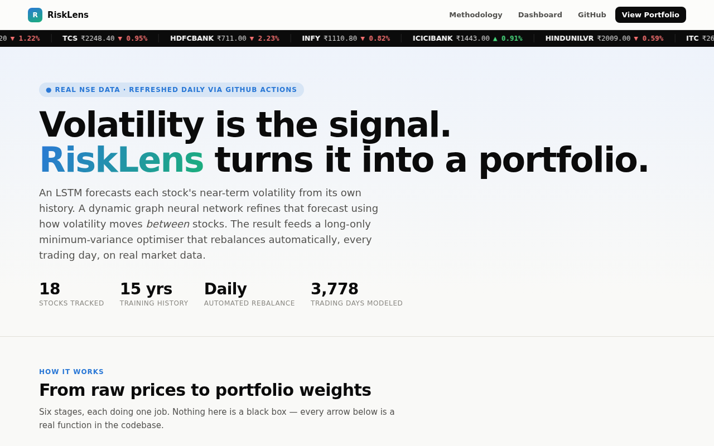
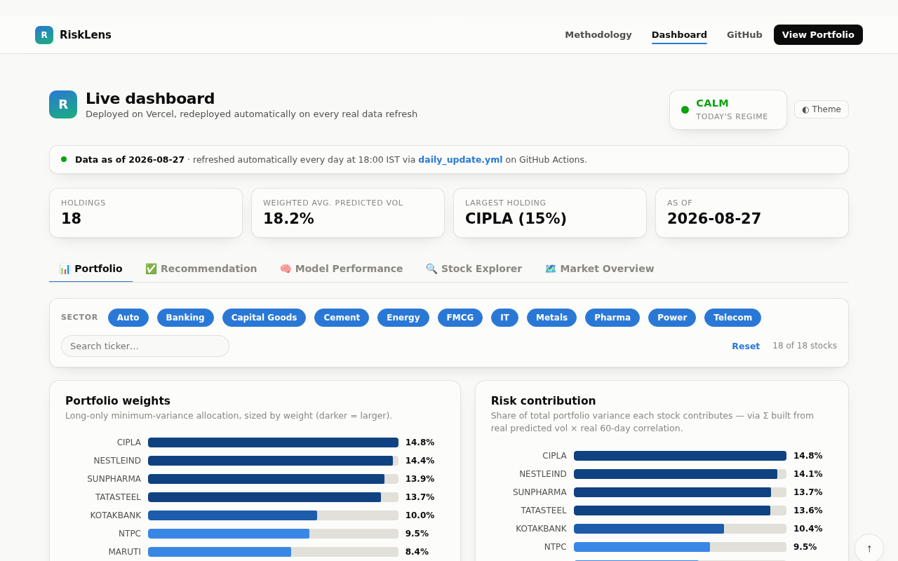
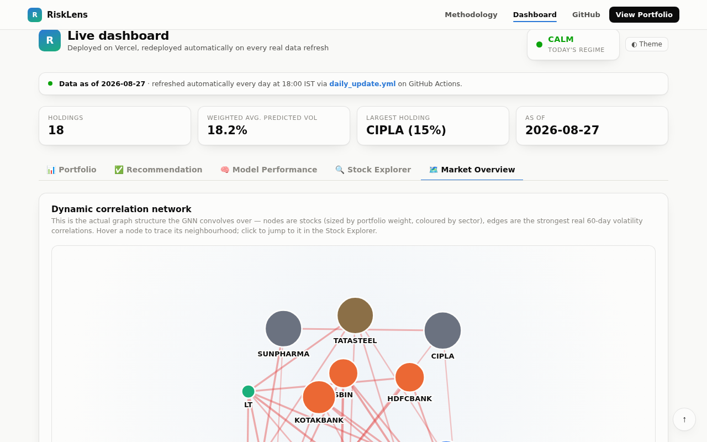

# RiskLens

**LSTM + dynamic Graph Neural Network volatility forecasting, feeding a real, daily-rebalanced minimum-variance portfolio.**

[](https://risk-lens-orcin.vercel.app)
[](https://github.com/umasuthanpalaniappan/RiskLens/actions/workflows/daily_update.yml)
[](LICENSE)

**[🔴 Live Dashboard →](https://risk-lens-orcin.vercel.app)** — real NSE data, real models, real portfolio, redeployed automatically every day. No login, no setup, just open it.



---

## What it does

For 18 large/mid-cap NSE stocks, RiskLens:

1. **Forecasts volatility** — not returns. Two models, trained and compared head-to-head:
   - **LSTM baseline** — a single-stock model scored from each stock's own return/volatility history.
   - **Dynamic GNN** — the same LSTM encoder, refined by a graph convolution over a graph that's *re-estimated on a rolling 60-day window*, so the graph structure itself evolves over time. Edges come from cross-stock **volatility correlation** (not price correlation) — vol clustering is what's actually relevant to forecasting where volatility goes next. A learnable per-stock gate blends the graph-refined signal with the plain LSTM signal.
2. **Builds a portfolio** — turns today's predicted volatilities into a long-only **minimum-variance** allocation (deliberately not Markowitz — see [why](#why-minimum-variance-not-markowitz)).
3. **Classifies the market regime** — calm / normal / crisis, from trailing volatility quantiles.
4. **Runs itself** — a GitHub Actions workflow re-runs inference every trading day after NSE close and pushes updated results, which auto-redeploys the live dashboard via Vercel's Git integration. Nobody has to touch this for it to stay current.

## Screenshots

| Live dashboard | Dynamic correlation network |
|---|---|
|  |  |

The network (Market Overview tab) is drawn from the signed 60-day correlation of daily **returns** — the same matrix that builds the portfolio's risk model (red = move together, blue = move opposite), with nodes sized by real portfolio weight. The GNN's own graph is built the same way every day, but from realised **volatility** rather than returns. Hover to trace a stock's neighbourhood; click to jump straight to it.

## Current results

| Model | Test direction accuracy | Test MAE | Test MSE |
|---|---|---|---|
| LSTM baseline | 71.3% | 0.534 | 0.739 |
| GNN — graph-only head | 50.3% (≈ coin flip) | 0.679 | 1.423 |
| GNN — LSTM-only head (inside the GNN) | 68.7% | 0.783 | 1.413 |
| **GNN — blended (deployed)** | **70.9%** | **0.529** | **0.757** |

*(Direction accuracy = correctly calling whether 5-day-ahead realised volatility rises or falls, on a held-out chronological test split of real NSE data. See the [live Model Performance tab](https://risk-lens-orcin.vercel.app/#dashboard) for current numbers — this table is from the 9 Oct 2026 retrain (full detail in [`docs/metrics.md`](docs/metrics.md)); it updates when the model is retrained and isn't guaranteed to match what you see live.)*

We report the graph-only number deliberately: it's close to chance on its own. The blend has the lowest MAE but not the best direction accuracy or MSE; the gap to the plain LSTM is within run-to-run noise, so read the two as comparable. The value of the graph is as a small learned correction through the per-stock gate, not a graph doing the heavy lifting by itself. **This is a research/educational project — not financial advice.**

## Table of contents

- [Why minimum-variance, not Markowitz](#why-minimum-variance-not-markowitz)
- [Architecture](#architecture)
- [Data](#data)
- [Setup](#setup)
- [Running the pipeline](#running-the-pipeline)
- [Daily automation](#daily-automation)
- [Dashboards](#dashboards)
- [Tests and CI](#tests-and-ci)
- [Regime classification](#regime-classification)

## Why minimum-variance, not Markowitz

Classic Markowitz mean-variance optimisation needs a forecast of *expected
returns* as well as risk. RiskLens's models are trained to predict
**volatility**, not returns — there's no honest signal here for expected
return, and fabricating one just to run a "real" Markowitz optimiser would
mean optimizing against a made-up number. Instead, `portfolio.py` builds the
predicted covariance matrix Sigma from predicted volatilities and the
recent correlation structure, and solves for the long-only weights that
minimise portfolio variance `w' Sigma w` subject to full investment and a
per-name cap. A volatility model has no honest way to prefer one stock's
*return* over another's — it can only tell you which combination of stocks
is currently the least risky, which is exactly what min-variance computes.
The regime classification is used only as a light risk overlay (blending
the optimiser's output toward equal weight when the market looks crisis-y),
not a second forecasting model.

## Architecture

```
src/
  config.py     # single source of truth: universe, paths, hyperparameters
  data.py       # yfinance download + local CSV cache (data/raw/prices.csv)
  features.py   # log returns, realised vol, momentum, volume z-score, RSI, MACD
  graph.py      # rolling correlation adjacency, graph Laplacian
  dataset.py    # windowing, chronological train/val/test split, norm stats
  models.py     # LSTMVolModel, GNNVolModel (+ GraphConvLayer, gate alpha)
  train.py      # training loops shared by both scripts; saves weights + results
  evaluate.py   # MSE / direction-accuracy metrics (shared, no duplication)
  portfolio.py  # predicted_covariance(), optimize() — min-variance QP
  regime.py     # current_regime() — calm/normal/crisis quantile classifier

scripts/
  run_lstm.py       # trains LSTMVolModel -> models/lstm.pt, results/lstm_results.json
  run_gnn.py        # trains GNNVolModel  -> models/gnn.pt,  results/gnn_results.json,
                     #                       results/norm_stats.json (mu/sd for live inference)
  run_portfolio.py  # live daily inference: loads gnn.pt + norm_stats.json, pulls the
                     # latest prices, predicts vol, builds Sigma + the graph Laplacian
                     # from the most recent 60-day window, classifies the regime, solves
                     # the portfolio, writes results/portfolio_weights.json
  export_dashboard_data.py  # aggregates results + full market history into web/data.json

app/
  dashboard.py  # local Streamlit dashboard (dev tool)

web/
  index.html    # the live dashboard — static site, deployed on Vercel
  data.json     # generated by export_dashboard_data.py, committed on every refresh

.github/workflows/
  daily_update.yml       # cron @ 12:30 UTC (18:00 IST) -> live inference -> commit results/
  train_models.yml       # manual: full LSTM+GNN retrain -> commit models/ + dataset/
  export_dashboard_data.yml  # manual: regenerate web/data.json only
```

Nothing is duplicated between scripts: all data prep, normalisation, model
definitions and metrics live in `src/`, and each entry-point script is a
thin wrapper around it.

## Data

`src/data.py` downloads daily adjusted-close prices *and* traded volume for
an 18-stock NSE universe (`config.TICKERS`, spanning banking, IT, energy,
FMCG, telecom, pharma, auto, cement, metals and power — see
`config.SECTOR_MAP`) via `yfinance` in a single request, caching each to
`data/raw/prices.csv` / `data/raw/volume.csv`. `run_lstm.py`/`run_gnn.py`
use the cache when present; `run_portfolio.py` always refreshes it, since
it needs today's close.

Each stock is represented by six features (`config.FEATURE_COLUMNS`):
daily log return, trailing realised volatility, `MOMENTUM_WINDOW`-day
cumulative return (trend), a rolling z-score of traded volume (unusual
activity), RSI(`RSI_WINDOW`) and a price-normalised MACD histogram (both
standard precursors to a volatility regime shift). All six feed both the
LSTM and the GNN encoder.

### The committed dataset

`data/raw/` is a gitignored *live cache* — it exists so repeated local runs
don't re-hit the network, not as a versioned artifact. For a fixed,
inspectable copy of the actual data the currently-committed `models/*.pt`
were trained on, see [`dataset/`](dataset/): `dataset/prices.csv` and
`dataset/volume.csv` are a snapshot of the real 18-stock, ~15-year NSE
history, regenerated and committed automatically every time
`train_models.yml` runs (see `dataset/README.md` for the exact date range).

History spans `config.START_DATE` (2011-01-01, ~15 years) to today.
`run_portfolio.py`'s daily refresh always re-downloads that full span (not
just a short live window) before persisting the cache, specifically so the
dashboard's Market Overview tab keeps its full multi-year history instead
of being truncated down to a few hundred days every time the daily job
runs — it just returns the trailing window it actually needs to the caller.

If a ticker in `config.TICKERS` is ever delisted, renamed, or otherwise
stops resolving on Yahoo Finance (this happens — corporate actions like
mergers/demergers retire old symbols), `data.py` raises a clear error
naming the ticker rather than failing downstream with a cryptic empty-data
crash. Fix it by swapping the symbol in `config.TICKERS`/`config.SECTOR_MAP`
and retraining.

**All models, results, and the dataset currently committed to this repo were
trained end-to-end on real, live NSE market data** pulled by GitHub Actions
runners (which have real internet access) — not synthetic data. Every
retrain is a real `train_models.yml` run you can inspect in the
[Actions tab](https://github.com/umasuthanpalaniappan/RiskLens/actions).

## Setup

```bash
python3 -m venv .venv
source .venv/bin/activate   # .venv\Scripts\activate on Windows
pip install -r requirements.txt
```

## Running the pipeline

```bash
python scripts/run_lstm.py        # trains the LSTM baseline
python scripts/run_gnn.py         # trains the GNN, saves norm_stats.json
python scripts/run_portfolio.py   # live daily inference -> portfolio_weights.json
python scripts/export_dashboard_data.py  # -> web/data.json
streamlit run app/dashboard.py    # or: python3 -m http.server, from web/
```

Run them in that order the first time — `run_portfolio.py` needs the GNN
weights and normalisation stats that `run_gnn.py` produces, and both
dashboards need `results/*.json` to exist.

## Daily automation

`.github/workflows/daily_update.yml` runs on a cron of `30 12 * * *` (UTC),
i.e. 18:00 IST, after the NSE market close. It installs
`requirements.txt` (CPU-only PyTorch first — the default wheel pulls ~3 GB of CUDA libraries and once filled the runner disk), runs `scripts/run_portfolio.py` (inference only — it
does not retrain the models) and `scripts/export_dashboard_data.py`, and
commits `results/` + `web/data.json` back to the repo as the
`github-actions[bot]` identity. GitHub starts scheduled runs late (often hours), so the update lands in the evening or night rather than at exactly 18:00. Every run — including a failed one — also commits `web/status.json` (time, result, the date of the data the dashboard holds). If a run fails, an issue titled *Daily RiskLens update is failing* is opened and assigned to the repo owner, and it closes itself when a run succeeds again. The price download ends the day after the last finished NSE session (IST-aware, from 16:00), so each evening's close is included. It
does not retrain `models/*.pt`; retraining is a separate, manual step
(`run_lstm.py` / `run_gnn.py`) since it's compute-heavier and the
universe/graph structure doesn't need to be re-learned every day.

`.github/workflows/train_models.yml` is that manual retraining step, run as
a GitHub Actions job (`workflow_dispatch` only — no schedule). It installs
`requirements.txt`, runs `scripts/run_lstm.py` then `scripts/run_gnn.py`,
snapshots the training data to `dataset/`, and commits `models/*.pt` +
`results/*.json` + `dataset/` + `web/data.json` as `github-actions[bot]`,
only if anything changed. Trigger it from the Actions tab whenever you want
the models retrained on the latest history.

Because `web/data.json` is committed on both workflows, and Vercel's Git
integration is connected to this repo, **every real data refresh triggers a
real redeploy** of the live dashboard — no client-side polling, no stale
snapshots.

## Dashboards

Two dashboards read the same result JSONs:

- **[`web/index.html`](web/index.html)** — the one deployed live on Vercel.
  A static site (no framework, no build step) that fetches `web/data.json`
  at load time. Sections: Methodology, Portfolio (filterable, sortable,
  sector allocation, risk contribution), Recommendation (with an honest
  reliability readout), Model Performance, a full per-stock Stock Explorer
  (price/volume/volatility history, 1Y–Max lookback), and Market Overview
  (the correlation network graph, a correlation heatmap, and regime
  history). Responsive, light/dark themed with persisted preference, and
  built with the same real ~15-year data as everything else.
- **[`app/dashboard.py`](app/dashboard.py)** — a local Streamlit app for
  development; covers the same core data without the extra sections above.

## Tests and CI

```bash
pip install pytest        # on top of requirements.txt
python -m pytest          # ~60 fast tests, no network access needed
```

`tests/` covers the minimum-variance optimiser (valid long-only capped weights, the 35% cap, the two-stock closed-form solution, the regime overlay), the regime classifier, feature engineering (including a guard that no feature ever looks ahead), the correlation graph and Laplacian, the evaluation metrics, the model shapes and the gate, seeding, and the data end-date logic. `.github/workflows/tests.yml` runs them on every push and pull request (skipping runs that only touch the bot's data files or docs). Training is seeded (`train.set_seed`, seed in `config.SEED`), so a retrain on the same data reproduces.

## Regime classification

`regime.current_regime()` computes the equal-weight average trailing
realised volatility across the universe and buckets the latest value
against its own trailing-3-year quantiles: below the 33rd percentile is
"calm", above the 85th is "crisis", otherwise "normal". It's intentionally
simple and auditable rather than a latent-state model.

---

<sub>Built for 23MAT204 (Mathematics for Intelligent Systems 3). Not financial advice — RiskLens forecasts volatility, not returns, and makes no claim about expected performance. See [LICENSE](LICENSE).</sub>
